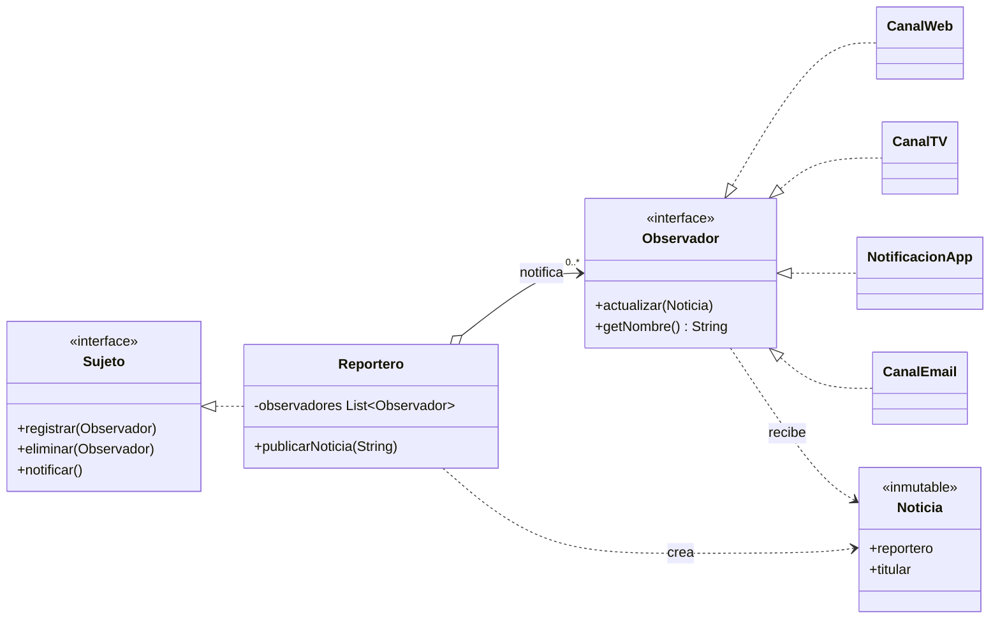

<div align="center">

# Sistema de Noticias — Patrón Observer


> Patrones de comportamiento aplicados a un sistema de noticias: reporteros que publican y canales (Web, TV, App, Email) que se suscriben, sin acoplamiento entre ellos.

## Descripción

</div>

---

Proyecto de **Reutilización de Software** que resuelve un sistema de distribución de noticias con el patrón de comportamiento **Observer**. Cada reportero actúa como **sujeto** y mantiene una lista de **observadores** (canales). Cuando publica una noticia, notifica a todos sus suscritos sin conocer sus clases concretas. El proyecto parte de una versión **sin patrón**, con acoplamiento fuerte, y la evoluciona por etapas: solución base, extensión con un canal nuevo, suite de pruebas y una alternativa con el mecanismo nativo del JDK.

## Temas cubiertos

| Tema | Descripción |
|---|---|
| Problema sin patrón | Cada reportero instancia y llama directamente a Web, TV y App |
| Patrón Observer | Interfaces `Sujeto` y `Observador`, registro, baja y notificación |
| Extensibilidad (OCP) | Nuevo `CanalEmail` añadido sin modificar `Reportero` |
| Robustez | Sin duplicados, `null` ignorado, bajas durante la notificación, fallos aislados |
| Pruebas | 12 pruebas sin dependencias externas, incluida una de arquitectura |
| Alternativa del JDK | `java.beans.PropertyChangeSupport` como Observer nativo |

## Arquitectura



## Contenido del repositorio

| Carpeta | Descripción |
|---|---|
| `sinpatron/` | Versión inicial con acoplamiento fuerte (reportero → canales concretos) |
| `sinpatron_ext/` | La misma versión al añadir Email: obliga a modificar cada reportero |
| `etapa1_base/` | Solución con Observer: `Sujeto`, `Observador`, `Reportero`, Web/TV/App |
| `etapa2_extension/` | Extensión con `CanalEmail` sin tocar el sujeto |
| `etapa3_pruebas/` | Suite `PruebasObserver` con 12 pruebas (T01–T12) |
| `etapa4_alternativa/` | Implementación con `PropertyChangeSupport` del JDK |
| `docs/` | Diagramas UML (`.dot` / `.png`), capturas y trazas de ejecución |

## Ejecución

Requiere **JDK 16+** (probado con JDK 21). Cada etapa es independiente:

```bash
cd etapa1_base
javac -encoding UTF-8 -d out $(find src -name "*.java")
java -cp out com.unir.noticias.Main            # modo interactivo
java -cp out com.unir.noticias.Main --demo     # escenario de ejemplo

cd ../etapa3_pruebas
javac -encoding UTF-8 -d out $(find src test -name "*.java")
java -cp out com.unir.noticias.PruebasObserver src   # 12 pruebas
```

Las salidas de la versión sin patrón, la versión Observer y la alternativa con `PropertyChangeSupport` son idénticas (ver `docs/t_diff.txt`).

## Contexto académico

**Asignatura:** Reutilización de Software · **Institución:** Ingeniería Informática  
**Autor:** Alejandro De Mendoza — Ingeniero Informático · Especialista en IA

---

## Autor

**Alejandro De Mendoza**  
Ingeniero Informático · Especialista en IA · Especialista en Ingeniería de Software · Máster en Arquitectura de Software

[](https://github.com/AlejoTechEngineer)
